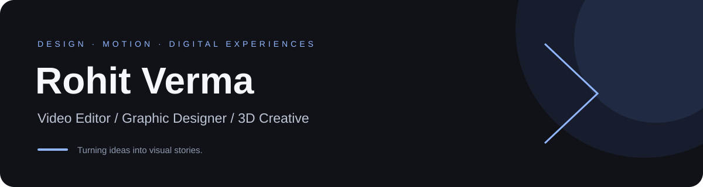

Video editing · Graphic design · 3D visuals · Creative technology

### Hi, I'm Rohit 👋

I'm a video editor, graphic designer and 3D creative who enjoys bringing ideas to life through visuals, motion and storytelling. Here on GitHub, I'm exploring the technology behind creative work—from websites to automation.

### What I create

| Focus | My approach |
| :--- | :--- |
| Video & motion | Engaging edits, brand films and visual storytelling |
| Graphic design | Clear typography, thoughtful layouts and brand creatives |
| 3D visuals | Product imagery and dimensional creative concepts |
| Creative technology | Exploring websites, AI tools and workflow automation |

### Currently exploring

- Building a digital home for my creative work.
- Connecting design and motion with interactive experiences.
- Making repetitive creative tasks simpler through automation.

### On GitHub

Explore my [public repositories](https://github.com/itachi4621-ops?tab=repositories) to see what I'm building and learning.

<!-- METRICS:START -->
<!-- Metrics cards appear here after the first successful workflow run. -->
<!-- METRICS:END -->

---

Visual storytelling meets creative technology.

